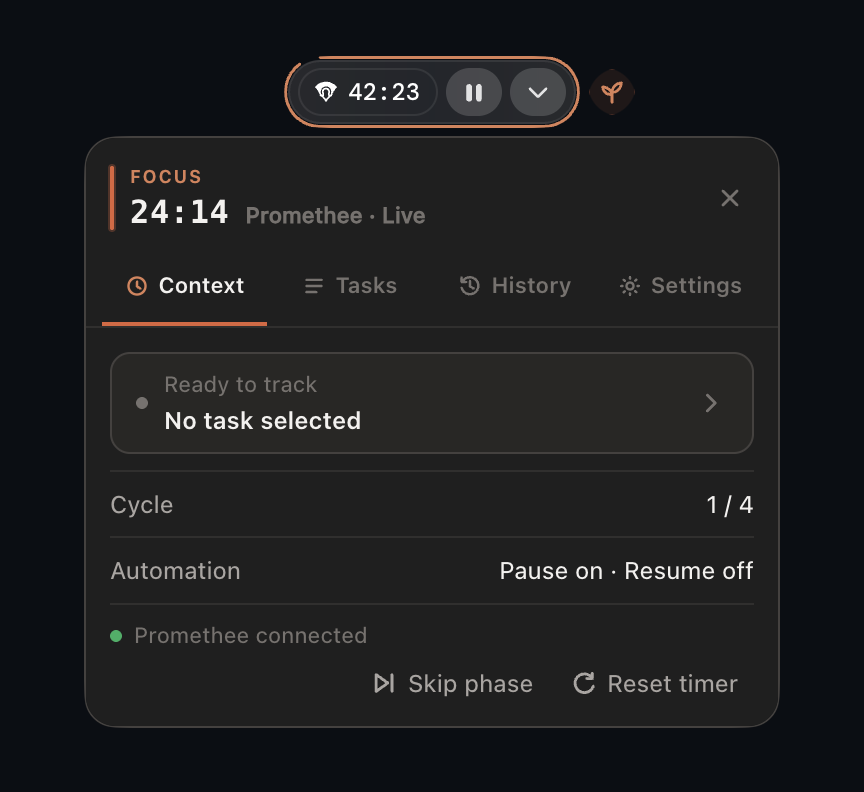

<p align="center">
  
</p>

# Promethee Pomodoro

> A local-first Pomodoro companion that lives around Promethee's real timer.

Promethee Pomodoro adds focus cycles, task-based time tracking, and freelance-ready CSV reports without creating a second work timer. Promethee stays in control of the real session; the companion adds a thin consuming outline and a compact attached menu.

The project is open source and built with Electron, TypeScript, and npm for macOS and Windows.

<p align="center">
  
</p>

## What it does

- Runs configurable focus, short-break, long-break, and cadence cycles.
- Draws progress around the real Promethee HUD: orange for focus, neutral gray for breaks.
- Keeps Promethee's own Play/Pause control visible and authoritative.
- Offers four compact tabs: **Context**, **Tasks**, **History**, and **Settings**.
- Reads available Promethee tasks through a strict read-only local integration.
- Can pause Promethee once when focus ends on macOS; automatic Resume is available but disabled on new installs.
- Includes local **Reset timer** and **Skip phase** actions. Skip focus reuses the existing safe Pause path; Skip break moves locally to Ready.

## Why it feels native to Promethee

The companion follows Promethee instead of competing with it. Its outline adapts to the real running and paused HUD widths, consumes smoothly around the pill, and never replaces Promethee's session controls. The attached menu uses Promethee's dark surfaces, warm orange accent, compact spacing, and French/English tone.

If identity, geometry, or placement is unsafe, the attached outline and handle hide instead of guessing. The permission/onboarding menu and geometry-recovery menu can still open centered in the current display without depending on Promethee HUD geometry; they return to the attached placement after current geometry recovers.

## Per-task time tracking

Select a task in **Tasks** and work normally in Promethee. Time accrues locally only while Promethee's real timer is observed as running.

- Switching tasks closes and saves the previous interval.
- **Stop tracking** closes the current interval, clears the selected task, and keeps saved history.
- A retained task/project snapshot keeps old entries readable if the source task later disappears.
- **History** loads newest-first in pages of 100. **Load older** reaches the rest of the retained ledger so any entry can be deleted.
- Today and Monday-based week totals use daylight-saving-aware local calendar boundaries.
- **Export CSV** writes a spreadsheet-safe, freelancer-oriented report with UTC timestamps and durations.

History lives in Electron's per-user application-data directory as `task-time-v1.json`. The ledger keeps the newest 10,000 closed entries within a snapshot strictly below 8 MiB. Corrupt or future-version files are preserved and fail closed instead of being overwritten. Promethee session identifiers are never stored or exported.

## Install

Install V1 with Node.js 22.12+ and npm:

```bash
npm install --global promethee-pomodoro@1.0.1 --no-audit --no-fund
promethee-pomodoro
```

On macOS, the first command prepares a branded `Promethee Pomodoro.app` in `~/Applications` when the CLI is launched. On Windows, the CLI starts the packaged Electron runtime directly. Native publisher certificates are deliberately deferred for V1, so operating-system reputation warnings can still appear.

### macOS source installation

To build the same app from a reviewed checkout on macOS 14 or newer:

```bash
./install-electron.sh
open "$HOME/Applications/Promethee Pomodoro.app"
```

The installer downloads the locked Electron runtime, builds the app, copies the allowlisted production files and icon, backs up an existing local app, and installs into `~/Applications` by default. It is a mutating installer, not a validation command. The resulting app is locally ad hoc signed, not Apple Developer ID signed or notarized. Because each ad hoc build has a changing `cdhash` designated requirement, the installer then resets only the Accessibility and ScreenCapture TCC entries for the current and retired Promethee Pomodoro bundle identifiers. It never grants either permission: you must revalidate and grant them again after every V1 rebuild/install. This reset is a local V1 workaround, not the long-term update model; a future Apple Developer ID signed build is the stable identity solution.

On first launch, the macOS setup panel first checks **Control the timer** and **Read the timer** without showing an OS prompt. It opens centered in the current display when screen reading or safe HUD geometry is unavailable. **Check again** performs the same prompt-free preflight. After that initial refresh and once onboarding is visible, the app may automatically invoke the native permission request at most once per process when a required capability is missing. macOS may show the Accessibility prompt and register the app; you still open System Settings and control the final toggles. The app never requests a permission between Pomodoro phases. **Control the timer** reflects the native helper's Input Events status. **Read the timer** is stricter: the helper must report Screen Recording and the app must pass a bounded probe through the real `/usr/sbin/screencapture`; the probe image is never retained. Until both checks pass, the primary button says **Allow**, which can retry the native request explicitly. Screen reading is required to attach the Pomodoro. Timer control is optional only when automatic Pause and Resume are both off: after screen reading passes, **Not now** persists that passive mode and does not reopen permission recovery or request Input Events on later launches just because timer control is absent. **Not now** is refused while screen reading is unavailable. If Screen Recording changes from missing to granted, the app schedules one relaunch: it revokes automation authority, aborts in-flight native work, stops polling, waits at most 750 ms for queued preferences and local time-history checkpoints, then calls `app.relaunch()` and `app.exit(0)`. After relaunch, both green rows make the button **Continue**. **Open** remains available for manual System Settings review, and the app never changes the final macOS privacy toggles for you. Use **Settings → Permissions → Review** at any time to reopen the panel; reviews and setting changes preflight current capabilities, while **Allow** remains the explicit retry path. Enabling automation later remains a separate Settings choice. Denial or revocation stays fail-closed and no phase transition opens a deferred permission prompt. A local ad hoc rebuild may require granting access again. Launching the app again while it is already running brings the single popup forward—centered if recovery is required, attached when screen reading and current HUD geometry are available—instead of creating another instance.

A local lifecycle smoke check on 2026-08-26 confirmed that a second launch reopened the popup and that a `TERM` quit followed by a manual reopen succeeded. The real Screen Recording grant → automatic relaunch path still requires user validation on macOS.

See the [distribution guide](docs/releases/distribution-and-updates.md) for the release boundary and rollback model.

## How to use it

1. Open Promethee and show its compact timer with an active or paused session.
2. Launch Promethee Pomodoro, complete the two-grant macOS setup when shown, then choose a task in **Tasks**.
3. Work through Promethee's real controls. The outline consumes during focus and break; configure durations and automation in **Settings**.
4. Review local totals in **History**, load older entries when needed, delete individual records, or export a CSV.

Before first-launch setup is resolved, new macOS installs start with automatic Pause enabled and automatic Resume disabled. After the Screen Recording status plus bounded screen-reading probe pass, choosing **Not now** persists both settings as off and skips Input Events without reopening permission recovery; while screen reading is unavailable, the app keeps setup open because it cannot attach to the HUD. Later enabling either automation setting remains explicit. Existing saved preferences are preserved. `PROMETHEE_POMODORO_DISABLE_AUTOMATION=1` disables all Promethee automation. Windows provides no automatic Pause/Resume in V1.

## Local-first privacy

- Promethee is opened read-only for allowlisted task/project and minimal current-timer observations.
- Promethee Pomodoro never writes tasks, sessions, or time history back to Promethee.
- Local history contains task/project snapshots and reporting timestamps, but no Promethee session identifier.
- No telemetry is included.
- The only product network action is a manual update check for the project's GitHub Release page; it sends no Promethee or history content and installs nothing.

Exported CSV files live at the location you choose and are outside the app's retention or uninstall flow. They are reporting aids, not invoices or tamper-evident accounting records.

## Language

The interface follows the primary operating-system language:

- French when the language begins with `fr`;
- English for every other language.

## Platform status

| Platform | Current V1 behavior | Status |
| --- | --- | --- |
| macOS 14+ arm64 | Attached HUD/menu, local tracking/history/CSV, bounded Pause/Resume path | Exact release-tarball installation/Electron/helper smoke passed; one narrow Promethee 1.3.29 flow recorded; locally ad hoc signed, not Apple Developer ID signed or notarized |
| macOS 14+ x64 | Same intended feature set | Exact release-tarball installation/Electron/helper smoke passed; live Promethee proof pending |
| Windows x64 | Passive HUD attachment, tasks/session observation, local tracking/history/CSV, manual Pomodoro transitions | Exact release-tarball installation/Electron/helper smoke passed; automation unavailable and live Promethee proof pending |
| Linux, Windows arm64, other targets | None | Unsupported |

V1 is distributed as an npm runtime package rather than a signed native installer. There is no Apple Developer ID, notarization, or Windows Authenticode release. The release workflow built the native helpers independently, assembled one immutable tarball, and smoke-launched that exact installed artifact on macOS arm64, macOS x64, and Windows x64 before publication.

## Development and contributing

Start with the [documentation index](docs/README.md), [product scope](docs/product-scope.md), [architecture](docs/architecture/target-architecture.md), [validation strategy](docs/development/validation-strategy.md), and [project contract](PROJECT.md).

Dependency installation, live Promethee exercises, publishing, signing, and deployment require separate explicit authorization. Release work starts in the [V1 distribution guide](docs/releases/distribution-and-updates.md); durable decisions are indexed in the [ADR register](docs/architecture/decisions/README.md).

## License

Promethee Pomodoro is available under the [MIT License](LICENSE).
